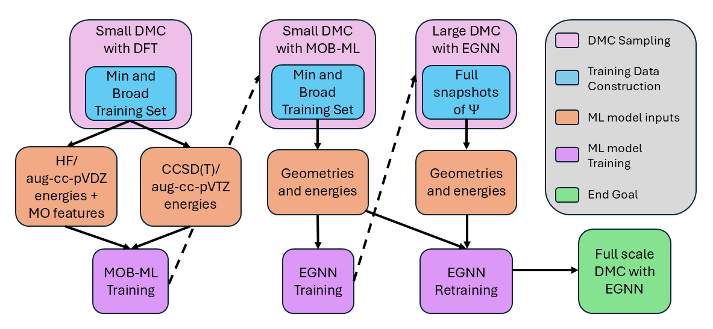

# Machine-Learned Potential Energy Surfaces for Diffusion Monte Carlo

Many of the molecules and ions we study are *floppy*: even in their ground vibrational state they move in large amplitudes, break and re-form hydrogen bonds, and can sample several minima on their potential energy surface (PES). Diffusion Monte Carlo (DMC) handles these systems well because it captures their full anharmonicity and nuclear quantum effects. The cost is a very large number of potential energy evaluations: a single converged DMC simulation can need on the order of **10⁹ energy evaluations**, and every isotopologue or excited state we want to study adds more.

That cost raises two problems. Even when a good fitted potential exists, evaluating it 10⁹ times can dominate the cost of a calculation. For many interesting systems no potential exists at all, and CCSD(T)-quality electronic structure calculations are far too expensive to run directly at that scale.

Since 2021, the group has addressed both problems with machine learning. The guiding idea is that DMC needs an accurate description of the regions of configuration space that the ground-state wave function actually samples, and **DMC itself is an efficient way to find those regions**. This idea has grown, through several generations of students and collaborators, into an end-to-end workflow. That workflow produces GPU-accelerated potentials at CCSD(T) accuracy for systems that had no potential surface before.

---

## A Brief History of ML Potentials in the Group

### 2021: Neural-network potentials trained on DMC data (NN-DMC)
*DiRisio, Lu, and McCoy, J. Phys. Chem. A 2021*

The first step was to show that a neural network can learn a potential well enough for DMC when it is trained only on configurations from a **single small-scale DMC simulation**. That simulation ran on an existing potential surface. Once trained, the network is evaluated in massively parallel fashion on a **GPU**, so large DMC simulations cost the same no matter how expensive the original potential was.

- The approach was tested on three standard DMC systems: H₂O, (H₂O)₂, and the highly fluxional CH₅⁺. The test potentials were the Partridge–Schwenke surface for H₂O, the Jin–Braams–Bowman surface for CH₅⁺, and MB-pol for (H₂O)₂.
- **Mass scaling** was introduced to the training simulation. Reducing the atomic masses partway through the run pushes walkers into higher-energy regions, which DMC otherwise samples only sparsely.
- The Coulomb matrix was used as the molecular descriptor. **Sorting** its rows and columns built permutational symmetry into the descriptor, and this proved important for systems such as CH₅⁺ and the water dimer.
- Zero-point energies and wave functions agreed with those from the original potentials to within about 1 cm⁻¹. For a 10⁶-walker ensemble, the GPU-evaluated network was up to **10× faster** than the original potential. The same network also reproduced variational excited-state energies of water to within 1 cm⁻¹.

### 2022: Adding CCSD(T) accuracy with MOB-ML: the NN+(MOB-ML) approach
*Lu, Cheng, DiRisio, et al., J. Phys. Chem. A 2022, in collaboration with the Miller group at Caltech*

The next step replaced the existing analytic potential with energies computed *on the fly* at the coupled-cluster level. The group did this by pairing NN-DMC with **molecular-orbital-based machine learning (MOB-ML)**, developed by Miller and co-workers. MOB-ML uses Gaussian process regression to predict CCSD(T)-quality energies from the molecular orbitals of an inexpensive Hartree–Fock calculation.

- MOB-ML models trained on **no more than about 1000 structures** reached errors of about 1 cm⁻¹ for H₂O and CH₅⁺. By comparison, the established potentials for these molecules were fit to much larger sets of electronic energies.
- DMC run on the MOB-ML model generated the neural network's training data. The resulting **NN+(MOB-ML)** potentials gave CCSD(T)-quality energies at GPU speed.
- MOB-ML models trained on low-energy structures still described ground states that sample energies roughly twice as high. This held for CH₅⁺ and its deuterated analogues.
- The approach produced the **first potential surface for C₂H₅⁺**, a carbocation with a non-classical bridging proton. The group then used this potential to study isotope effects on its ground and excited states (Moonkaen, Finney, and McCoy, 2023).

### 2025: Larger hydrogen-bonded ions: OH⁻(H₂O)ₙ and H₃O⁺(H₂O)
*Jacobson, Cheng, et al., J. Phys. Chem. A 2025*

Hydroxide–water clusters with up to 11 atoms and four strongly interacting molecular units had no potential surfaces. To build them, the workflow was extended in three ways:

- **Δ-learning to the complete basis set (CBS) limit.** MOB-ML was generalized to learn the difference between Hartree–Fock energies in a small basis (aug-cc-pVDZ) and CCSD(T)/CBS energies. This removed the need to run Hartree–Fock in the large target basis.
- **More efficient use of DMC data.** Earlier protocols used fewer than 15% of the configurations generated by DMC. The new protocol runs much smaller simulations and uses all of the roughly 1.5 million sampled structures.
- **A better descriptor and architecture.** Three changes cut the test error for OH⁻(H₂O)₂ from about 94 cm⁻¹ to about 35 cm⁻¹: a Coulomb matrix sorted by *molecular unit* rather than by individual atom, wider hidden layers, and batch normalization.

### 2025: Potentials with more than one minimum: H₃O⁻
*Jacobson, Webb, Cheng, and McCoy, J. Phys. Chem. A 2025*

In all the earlier systems, the ground state stayed in one minimum or in a set of minima related by symmetry. H₃O⁻ has two chemically distinct isomers, H⁻·H₂O and OH⁻·H₂, separated by a low barrier. Training the NN+(MOB-ML) potential on DMC data started in *both* minima produced a single surface that describes both isomers and the path between them. This made it possible to run fixed-node DMC studies of excited states and isotope effects.

### 2026: GPU-native equivariant graph neural networks and many isomers
*Jacobson, Shao, Bakalov, Cheng, and McCoy, submitted 2026*

Hydroxide clusters with four or five water molecules have many low-symmetry isomers separated by small barriers. One potential has to describe all of them, and the paths between them, equally well. The current workflow, shown in the figure in the next section, adds:

- **Isomer-spanning sampling.** Only the oxygen masses are reduced, which encourages whole-molecule rearrangements and isomerization. A **farthest-point sampling** algorithm, applied in a principal-component space of interatomic distances, then picks a diverse, balanced training set.
- **DMC sampling for MOB-ML training as well.** DMC simulations run with DFT replace the high-temperature *ab initio* molecular dynamics trajectories used before. The training data then match the configurations that DMC actually samples.
- **A Matérn + linear kernel in MOB-ML.** The added linear term captures the near-linear dependence of the correlation energy and lowers MOB-ML test errors by nearly an order of magnitude. The target is DLPNO-CCSD(T)/aug-cc-pVTZ.
- **An equivariant graph neural network (EGNN).** Treating each molecule as a graph builds in translational, rotational, and permutational invariance directly, so no descriptor or sorting step is needed. One model covers every isomer without bias toward any of them, and training errors are roughly halved compared with the earlier feed-forward networks.
- **GPU acceleration.** The EGNN potentials run about **200× faster on a GPU than on a CPU** and about **7× faster than the previous neural network potentials**. This makes production DMC simulations with **10⁶ walkers** practical.

---

## The Current Workflow at a Glance

  

*The end-to-end workflow. Pink: DMC sampling steps. Blue: training-data construction. Orange: ML model inputs. Purple: model training. Green: production DMC.*

1. **Sample configurations with small DMC simulations.** Short runs started at each isomer of interest supply a *minimum* set near each minimum and a *broad* set from mass-scaled runs.
2. **Learn CCSD(T) energies with MOB-ML.** Gaussian process regression on Hartree–Fock molecular-orbital features gives coupled-cluster accuracy at roughly the cost of a Hartree–Fock calculation.
3. **Run DMC on the MOB-ML model** to generate on the order of 10⁶ structures and energies for neural network training.
4. **Train a GPU-accelerated neural network potential.** This is a feed-forward network in the earlier work and an EGNN in the current version.
5. **Validate, refine, and run production DMC.** The potential is tested against minima, transition states, and snapshots of the ground-state wave function. Wave-function snapshots are added back to the training set where needed.

---

## Code and Data

- **[PyVibDMC](https://github.com/McCoyGroup/pyvibdmc)**: the group's open-source Python implementation of diffusion Monte Carlo, used throughout this work.
- **OH⁻(H₂O)ₙ / H₃O⁺(H₂O) NN+(MOB-ML) potentials**: [github.com/McCoyGroup/ionic_water_mobml-nn_potential](https://github.com/McCoyGroup/ionic_water_mobml-nn_potential); training data at [zenodo.org/records/14563580](https://zenodo.org/records/14563580)
- **H₃O⁻ NN+(MOB-ML) potential**: [github.com/McCoyGroup/h3o_mobml-nn_potential](https://github.com/McCoyGroup/h3o_mobml-nn_potential)
- **OH⁻(H₂O)₂₋₅ EGNN potentials**: [github.com/McCoyGroup/ohwn_mobml_egnn_potentials](https://github.com/McCoyGroup/ohwn_mobml_egnn_potentials)
- **KA-GPR** (kernel-additive Gaussian process regression used in MOB-ML): [github.com/SUSYUSTC/KAGPR](https://github.com/SUSYUSTC/KAGPR)
- The TensorFlow model files for the 2021 H₂O, CH₅⁺, and (H₂O)₂ potentials are available in that paper's Supporting Information.

---

## Publications

1. R. J. DiRisio, F. Lu, and A. B. McCoy, "GPU-Accelerated Neural Network Potential Energy Surfaces for Diffusion Monte Carlo," *J. Phys. Chem. A* **125**, 5849–5859 (2021). [doi:10.1021/acs.jpca.1c03709](https://doi.org/10.1021/acs.jpca.1c03709)
2. F. Lu,\* L. Cheng,\* R. J. DiRisio,\* J. M. Finney, M. A. Boyer, P. Moonkaen, J. Sun, S. J. R. Lee, J. E. Deustua, T. F. Miller III, and A. B. McCoy, "Fast Near Ab Initio Potential Energy Surfaces Using Machine Learning," *J. Phys. Chem. A* **126**, 4013–4024 (2022). [doi:10.1021/acs.jpca.2c02243](https://doi.org/10.1021/acs.jpca.2c02243)
3. P. Moonkaen, J. M. Finney, and A. B. McCoy, "Isotope Effects on Ground and Excited States of Ethyl Cation, H⁺(C₂H₄)," *J. Phys. Chem. A* **127**, 1196–1205 (2023).
4. G. M. Jacobson,\* L. Cheng,\* V. C. Bhethanabotla, J. Sun, and A. B. McCoy, "Machine Learning Approaches for Developing Potential Surfaces: Applications to OH⁻(H₂O)ₙ (n = 1–3) Complexes," *J. Phys. Chem. A* **129**, 2958–2972 (2025). [doi:10.1021/acs.jpca.4c08826](https://doi.org/10.1021/acs.jpca.4c08826)
5. G. M. Jacobson, A. W. Webb, L. Cheng, and A. B. McCoy, "Diffusion Monte Carlo Study of the Structure and Spectroscopy of H₃O⁻," *J. Phys. Chem. A* **129**, 10928–10939 (2025). [doi:10.1021/acs.jpca.5c06590](https://doi.org/10.1021/acs.jpca.5c06590)
6. G. M. Jacobson, C. Shao, T. I. Bakalov, L. Cheng, and A. B. McCoy, "Machine-Learned Potentials for Accelerated CCSD(T)-level Evaluations: Applications to OH⁻(H₂O)ₙ (n = 2–5) Complexes," submitted (2026).

\*Equal contribution.

## Acknowledgments

This work has been supported by the National Science Foundation, Division of Chemistry (CHE-1856125, CHE-2154126, and CHE-2517458), the NSF Office of Advanced Cyberinfrastructure (OAC-1663636), and the Department of Energy CPIMS program (DE-SC0021081). Development of PyVibDMC was supported by a Molecular Sciences Software Institute fellowship (NSF OAC-1547580). Calculations were performed on the University of Washington's Hyak supercomputer, the Ilahie cluster, and at NERSC.rsity of Science and Technology), Vignesh Bhethanabotla and Jiace Sun (Caltech), and the Miller group for the development of MOB-ML.
